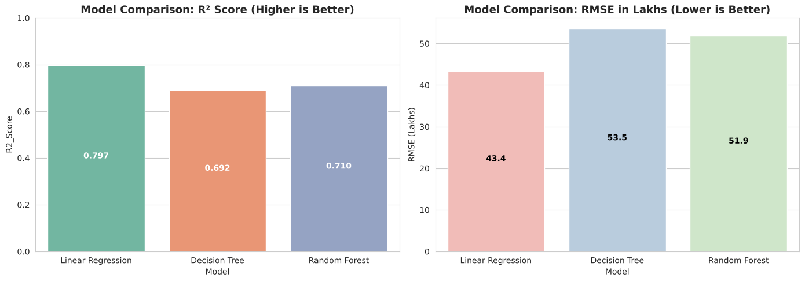

# Bengaluru House Price Prediction

An end-to-end machine learning regression project that estimates residential property asking prices in Bengaluru using location, total area, BHK and bathroom count. The repository includes the analysis notebook, dataset, trained model and a Streamlit prediction app.



## 🚀 Live Demo

**Try the application:**  
https://bengaluru-house-price-prediction-djvzdyutpryz4zk2fqv39g.streamlit.app/

## Project overview

- **Problem type:** Supervised machine learning — regression
- **Target:** House price (in lakhs of INR)
- **Input features:** Location, total square feet, BHK and bathrooms
- **Best model by R² and RMSE in the recorded hold-out evaluation:** Linear Regression
- **Interface:** Streamlit

## Dataset and preparation

The included CSV contains 13,320 raw listings and 9 columns. The notebook cleans missing values and inconsistent formats, converts square-foot ranges to numeric values, extracts BHK from the `size` field, groups infrequent locations into `other`, and applies domain/statistical outlier filters. The resulting modeling dataset contains 7,239 rows.

### Main workflow

1. Load and inspect the dataset.
2. Clean missing values and inconsistent `total_sqft` entries.
3. Explore price, area, BHK and location distributions.
4. Engineer BHK and price-per-square-foot helper features.
5. Reduce location cardinality and remove outliers.
6. One-hot encode location and split the data into 80% train / 20% test.
7. Train Linear Regression, Decision Tree and Random Forest regressors.
8. Compare models using MAE, RMSE and R².
9. Tune the Decision Tree with GridSearchCV.
10. Save the Linear Regression model and use it in the Streamlit app.

## Recorded model results

Results below are copied from the notebook's saved 80/20 hold-out evaluation. Prices and errors are in lakhs of INR.

| Model                       |             MAE |            RMSE |              R² |
| --------------------------- | --------------: | --------------: | ---------------: |
| **Linear Regression** |           18.02 | **43.41** | **0.7972** |
| Random Forest (50 trees)    | **15.29** |           51.91 |           0.7099 |
| Decision Tree               |           17.14 |           53.47 |           0.6923 |

The tuned Decision Tree achieved a test R² of **0.7173**, with `max_depth=20` and `min_samples_split=20`. Linear Regression has the strongest R² and RMSE, while Random Forest has the lowest MAE. The preferred metric depends on the business objective.

> Note: The notebook contains a 5-fold cross-validation section. Its output is not saved in the supplied notebook, so no cross-validation score is reported here. Run that notebook cell to generate the scores.

## Repository structure

```text
Bengaluru-House-Price-Prediction/
├── app.py                              # Streamlit prediction interface
├── Bengaluru_House_Data.csv            # Raw dataset
├── Bengaluru_House_Price_Prediction.ipynb  # Full analysis and modeling
├── house_price_model.joblib            # Trained model and feature-column order
├── requirements.txt                    # Python dependencies
├── .gitignore
└── images/
    └── model_comparison.png             # Model evaluation chart
```

## Run locally

### 1. Clone the repository

```bash
git clone https://github.com/<your-username>/Bengaluru-House-Price-Prediction.git
cd Bengaluru-House-Price-Prediction
```

### 2. Create and activate a virtual environment

**Windows (PowerShell):**

```powershell
py -3.11 -m venv .venv
.venv\Scripts\Activate.ps1
```

**macOS / Linux:**

```bash
python3.11 -m venv .venv
source .venv/bin/activate
```

### 3. Install dependencies

```bash
python -m pip install --upgrade pip
pip install -r requirements.txt
```

The saved model was serialized with **scikit-learn 1.9.0**. Keep that version when loading the provided `.joblib` file; scikit-learn does not guarantee compatibility of persisted models across versions.

### 4. Launch the app

```bash
streamlit run app.py
```

### 5. Explore or rerun the notebook (optional)

```bash
jupyter notebook Bengaluru_House_Price_Prediction.ipynb
```

Run the notebook from top to bottom to reproduce the data preparation and model evaluation. It expects `Bengaluru_House_Data.csv` in the same directory.

## Limitations

- Outlier filtering is performed before the train/test split and uses `price_per_sqft`, which is derived from the target price. This introduces target-information leakage into the filtering process and may make the reported hold-out metrics optimistic.
- Only four property inputs are used. Factors such as building age, floor, amenities, builder, property condition and exact micro-location are not represented.
- The source data contains listing/asking prices; these are not guaranteed to match final sale prices.
- Infrequent locations are grouped into `other`, reducing location-level detail.
- The model is an educational portfolio project, not a professional property valuation tool.

## Future improvements

- Split the data before fitting any outlier filters and preprocessing steps.
- Add stronger validation and compare regularized regression and gradient-boosting models.
- Add more property attributes and evaluate performance by location and price range.
- Deploy the Streamlit app and add automated tests.

## Tech stack

Python · Pandas · NumPy · Matplotlib · Seaborn · scikit-learn · Joblib · Streamlit · Jupyter Notebook

## 👨‍💻 Author

**Purushothaman S**

GitHub: [gokulvad1234](https://github.com/gokulvad1234)
